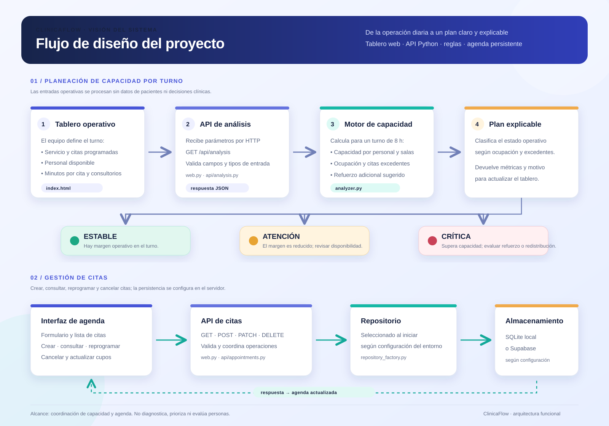

# ClinicaFlow

ClinicaFlow es un tablero de coordinación de capacidad clínica. Convierte cuatro variables operativas agregadas —citas programadas, personal de turno, duración de la cita y consultorios— en un plan explicable para el turno.

No usa clima, servicios externos ni datos de pacientes. No diagnostica, prioriza ni evalúa personas.

## Ejecutar

Requiere Python 3.10 o posterior.

```powershell
python main.py
```

Abre `http://127.0.0.1:8000`. Presiona `Ctrl+C` para detener el servidor.

Para guardar citas en Supabase, copia `.env.example` a `.env` y configura
`SUPABASE_URL` y `SUPABASE_SECRET_KEY` con las credenciales del proyecto.
El servidor carga `.env` al iniciar; si faltan ambas variables, usa SQLite
local. Nunca publiques `.env` ni expongas la clave secreta en el navegador.
Antes de usar Supabase, aplica la migración
`supabase/migrations/202610060001_create_appointments.sql` desde el SQL Editor
del proyecto.

En Vercel, configura `SUPABASE_URL` y `SUPABASE_SECRET_KEY` en
**Project Settings → Environment Variables** y vuelve a desplegar el proyecto.
La función de citas necesita ambas variables y guarda los datos en Supabase;
SQLite solo se usa en el servidor local.

## API

`GET /api/analysis` recibe `service`, `appointments`, `clinicians`, `minutes` y `rooms`. Retorna la capacidad total, ocupación estimada, citas sin capacidad y el refuerzo sugerido.

`GET`, `POST`, `DELETE` y `PATCH /api/appointments` consultan, crean,
cancelan y reprograman citas usando Supabase.

## Pruebas

```powershell
python -m unittest discover -s tests -v
```

## Arquitectura

```text
climastock/analyzer.py  Motor determinista de capacidad por turno
climastock/web.py       Servidor local y API
api/analysis.py         Función compatible con Vercel
index.html              Tablero operativo
tests/test_climastock.py Pruebas de reglas y contrato API
```

### Flujo del proyecto


